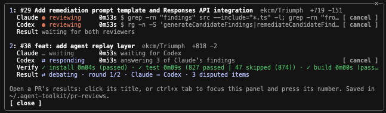

# agent-toolkit

Shared skills, mods and plugins for coding agents — Claude Code, Codex, pi, and anything else that reads the [Agent Skills](https://agentskills.io) format.

## Install

```sh
git clone https://github.com/ekcm/agent-toolkit.git ~/Documents/GitHub/agent-toolkit
cd ~/Documents/GitHub/agent-toolkit
./install.sh --dry-run   # preview
./install.sh
```

Then restart any running agents so they pick up the skills.

`install.sh` symlinks each folder in `skills/` into the user-level skill folder of every supported agent, so this repo stays the only copy:


| Folder                    | Read by                                           |
| ------------------------- | ------------------------------------------------- |
| `~/.agents/skills/<name>` | Codex, pi, and other Agent Skills tools           |
| `~/.claude/skills/<name>` | Claude Code (it does not read `~/.agents/skills`) |


It also:

- **Backs up instead of deleting.** Anything already at a target path is moved to `~/.agent-toolkit-backups/<timestamp>/`.
- **Removes old copies from** `~/.codex/skills`**.** Codex still reads that legacy folder as well as `~/.agents/skills`, so a copy left there makes each skill appear twice.
- **Links skill by skill**, never replacing a whole folder, so skills installed by other tools (e.g. `npx skills`) are left alone.
- **Is safe to re-run.** Links that are already correct are left as they are.

Don't also link skills into `~/.pi/agent/skills`: pi already reads `~/.agents/skills` and warns about duplicate names.

### Updating

Edits to a skill take effect immediately, since the agents read it through the symlink — just restart the agent. After adding, removing or renaming a skill, run `./install.sh` again. If the repo moves, run it again from the new location.

### Uninstalling

```sh
./install.sh --uninstall
```

This removes only the symlinks that point into this repo. Backups stay in `~/.agent-toolkit-backups/`; move a folder back from there to restore it.

The target folders can be overridden with `AGENTS_SKILLS_DIR`, `CLAUDE_SKILLS_DIR`, `CODEX_HOME` and `AGENT_TOOLKIT_BACKUP_DIR`.

## Skills

Each folder in `skills/` is a standard `SKILL.md` skill: frontmatter with only `name` and `description`, and plain instructions with no agent-specific tools.


| Skill                             | What it does                                                                  |
| --------------------------------- | ----------------------------------------------------------------------------- |
| `code-review-uncommitted-changes` | Strict review of uncommitted changes                                          |
| `verify-review`                   | Second-pass check that a prior review was implemented, plus a regression scan |
| `review-pull-request`             | Deep review of a GitHub PR via `gh`                                           |
| `retrieve-pull-request-comments`  | Fetch and summarise review comments on the current branch's PR                |
| `draft-pr-description`            | Write `PR.md` from the branch's commits and changes                           |
| `handover-session-notes`          | Save session context to `NOTES.md` for the next session                       |
| `repo-wiki`                       | Interactive, verified wiki of a repo or monorepo component, kept outside it   |


Invoke a skill by name — `/name` in Claude Code, `$name` in Codex.

## Claude Code mods

[Mods](https://www.claudemod.com/) change Claude Code itself (panels, commands, hooks), so unlike the skills they work in Claude Code only. Each lives in `mods/<name>/`, and this repo is a plugin marketplace that lists them.

To install from your local clone instead of GitHub, add it as a marketplace once with `claude plugin marketplace add ~/Documents/GitHub/agent-toolkit`, then install each mod as `<name>@agent-toolkit`. An install runs from a cached copy of the mod, so editing the clone changes nothing until you bump `version` in the mod's `plugin.json`, run `claude plugin marketplace update agent-toolkit` and `claude plugin update <name>@agent-toolkit`, and restart Claude Code. While working on a mod, start Claude Code with `claude --plugin-dir ~/Documents/GitHub/agent-toolkit/mods/<name>` instead: it loads the clone directly, and `/reload-plugins` picks up edits.

### pr-review-board

Reviews several PRs at once with Claude and Codex side by side, in a live panel. For each PR it runs both reviewers independently, combines their findings, runs the PR's install, tests and build, then has the two agents debate whatever they disagree on, and shows what both agree on, what was confirmed, withdrawn or still disputed, colour-coded by severity and tagged by source.



Install it in Claude Code:

```
/plugin install pr-review-board --marketplace ekcm/agent-toolkit
```

Or install from your local clone:

```
claude plugin marketplace add ~/Documents/GitHub/agent-toolkit
/plugin install pr-review-board@agent-toolkit
```

It needs `gh` logged in, the `claude` and `codex` CLIs on your `PATH`, and the `review-pull-request` skill installed with `./install.sh`.


| Command                            | What it does                                                                       |
| ---------------------------------- | ---------------------------------------------------------------------------------- |
| `/review-prs ~/path/to/repo 19 22` | Review PRs 19 and 22 of that repo (inside the repo, `/review-prs 19 22` is enough) |
| `/review-prs`                      | Open the panel                                                                     |
| `/review-prs trust owner/repo`     | Let PRs of a repo you don't own run their install, tests and build                 |
| `/review-prs untrust owner/repo`   | Undo that; `/review-prs trust` lists the approved repos                            |


Using the panel:

- Press ctrl+x tab to focus the panel, then a PR's number key to open its results (or click its title). Inside a PR, `1` shows the combined result, `2` Claude's review and `3` Codex's; `b` goes back.
- `x` (or `close`) closes the panel. Reviews keep running while it is closed, and `/review-prs` opens it again.
- Each row has `cancel` and `retry` per reviewer, `recombine` to redo the combine, verify and debate from the saved reviews, and `remove` to drop a finished review from the panel (its files stay).
- A PR number the repo doesn't have is reported in the command's reply and not added. Running a PR again after it finished starts a fresh review and overwrites its saved results.

What it touches:

- Each PR is checked out as a detached worktree at `~/.agent-toolkit/pr-reviews/<repo>/pr-<n>/worktree`, fetched into `refs/pr-review/<n>` of your local clone. Your own checkout and uncommitted changes are left alone.
- Both reviewers and the debate are read-only. Verification runs the PR's code, so it runs only for your own repos or ones you approved, and never for a branch from someone else's fork.
- Reviews, logs and the combined result (`reconciled.md`) are saved in `~/.agent-toolkit/pr-reviews/<repo>/pr-<n>/`, next to the worktree. To remove a review's worktree and ref:

```sh
git -C <repo> worktree remove --force ~/.agent-toolkit/pr-reviews/<repo>/pr-<n>/worktree
git -C <repo> update-ref -d refs/pr-review/<n>
```

### dev-statusline

A two-line status line for working across Claude Code and Codex: the repo, branch and the branch's PR on top, and how much room each agent has left below.

```
agent-toolkit (feat/statusline) · ✓ checks · 4/7 resolved
ctx ▰▰▰▱▱▱▱▱▱▱ 32% 64k/200k · claude 5h 58% left (2h10m) · codex 5h 55% left (1h05m)
```

Install it in Claude Code:

```
/plugin install dev-statusline --marketplace ekcm/agent-toolkit
```

Then point Claude Code's status line at it, in `~/.claude/settings.json` (this replaces any `statusLine` you already have):

```json
"statusLine": {
  "type": "command",
  "command": "sh ~/.agent-toolkit/dev-statusline/statusline.sh"
}
```

It needs macOS or Linux (it runs `sh`, `sed` and `find`), `gh` logged in for the PR part, the `codex` CLI logged in for the Codex figure, and `jq` for the subagent rows (macOS includes it); a part whose tool is missing is left out or shows `—`.

The mod keeps the figures and writes the two lines to `~/.agent-toolkit/dev-statusline/<session id>.txt`; that script, which the mod writes on start-up, prints the file for the session asking. Each session's file is removed when it ends, and leftovers older than a day are cleared on start-up. The lines show under the prompt, below Claude Code's own line with the permission mode, and update whenever Claude Code redraws its status line.

What each part shows:

- **PR:** the open PR for the current branch, from `gh` (its number is left out, since Claude Code's own line under the prompt shows it): `✓ checks`, `◷ 3 running` or `✗ 2 failing`, then resolved review threads out of all of them. It shows `no PR` when the branch has none, and drops the PR part when `gh` is missing, logged out or offline. It refreshes at the end of each turn and every minute.
- **ctx:** a gauge of the context window used, `▰` for used and `▱` for free, then the share used and tokens used out of the window (`32% 64k/200k`), straight from Claude Code.
- **claude 5h:** how much of Claude's 5-hour usage window is left, and the time until it resets, straight from Claude Code. It shows `—` off a subscription.
- **codex 5h:** how much of Codex's 5-hour window is left, and the time until it resets, live from your Codex account: the mod starts `codex app-server` for about a second, asks it for the account's rate limits (no tokens spent) and stops it. It needs the `codex` CLI on your `PATH`, logged in. If that fails, it falls back to the newest session log in `~/.codex/sessions` (or `$CODEX_HOME/sessions`), which is only as fresh as your last interactive Codex turn. It shows `—` when there is no reading.

Worktrees: inside a linked git worktree the first line still leads with the project, the main repository's folder name, followed by the worktree's folder, dim: `Muse/DEV-67 (feat/DEV-67-wiki-link-resolver)`. A detached checkout shows `(detached <commit>)`, and its PR is the open one containing that commit, so pr-review-board's review checkouts show their PR too.

Subagents: when Claude Code runs subagents, the mod also draws their rows in the agent panel under the prompt, as a tree. An agent launched by another agent sits under it:

```
├─ DEV-67                      running  6m42s  · ✓ checks · 0/5 resolved · Bash: npm test 34s · 48k tokens
└─ Generating wiki for my-app  running  4m40s  · Agent: Research frontend · 61k tokens
   ├─ Research core            running  3m50s  · Read extract.py · 52k tokens
   ├─ Research API             idle     3m50s  · nothing for 2m05s · 40k tokens
   └─ Research evals           ✓ done   in 2m50s · 35k tokens
```

Each row names the worktree the subagent works in (or the subagent, outside any worktree), then:

- **State and time:** `running` or `waiting` with how long it has been going; `✓ done in 2m50s` (green), `✗ failed after 1m10s` (red) or `stopped` once it ends. Claude Code keeps an ended row for a while, then drops it.
- **Idle:** a running agent with no model request or tool call in flight for a minute shows as `idle` (yellow) with `nothing for 2m05s`, so a stuck agent stands out from a busy one.
- **That worktree's PR**, as on the first line.
- **What it is doing now:** the tool call in flight, with the command, file, pattern or task it was given (`Bash: npm test`, `Read extract.py`, `Agent: Research core`), and how long it has been running once that passes 10 seconds; or `thinking` while it waits on the model. It is cut to fit the terminal's width.
- **Its tokens.**

When two or more subagents are at work, a third status line sums them up: `4 agents · 2 running · 1 idle · 1 waiting`.

The mod ships the rows as the plugin's `subagentStatusLine` setting, so they need no settings entry; it runs `~/.agent-toolkit/dev-statusline/subagents.sh`, which the mod writes on start-up. Claude Code gives that script each subagent's status, start time and tokens; the mod adds the rest from its hooks on subagents' model requests and tool calls, and the engine's list of agents (for who launched whom), in `~/.agent-toolkit/dev-statusline/<session id>.agents.json`. The main session's own tool calls are not tracked. The PR states come from one `gh` call listing the repository's open PRs, made only when the repository has more than one worktree.

Several sessions share one Codex reading: the first to need it asks Codex and saves it to `~/.agent-toolkit/dev-statusline/codex.json`, and the others reuse it for a minute.

Colours: checks and review threads are green, yellow or red, in your terminal's own colours. The repo name is bold in a darker Claude orange. The gauge's used segments, its percentage and `claude 5h` with its share left are Claude orange, and `codex 5h` with its share left is Codex lilac; a share left under 10% is also bold and underlined. `left`, the reset times, the free segments and the token count stay plain, and the separators, the branch's brackets and empty states (`no PR`, `no checks`, `no threads`, `—`) are dim. The brand colours need a terminal with 24-bit colour. The colours are set in one table, `COLORS` in `hooks/format.ts`.

